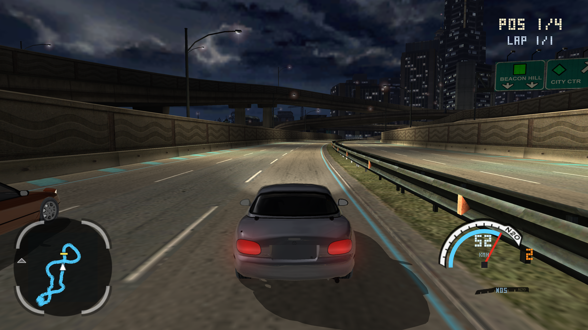

# OpenUG2

OpenUG2 is an open-source recreation of the **Need for Speed: Underground 2**
engine. You can explore Bayview, try races against AI, and preview car
customization. The project is still in development, and career mode is incomplete.

You need your own legally acquired copy of Underground 2. OpenUG2 uses the
folder containing `CARS`, `TRACKS`, and `GLOBAL`.

## Get started

**Download a preview** from [GitHub Releases](https://github.com/whoismept/OpenUG2/releases).
The [desktop setup guide](docs/TEST_BUILDS.md) covers Windows, Linux, and macOS.

**Build from source** with the [build dependencies](docs/PLAYING.md#build-from-source)
installed. Windows users can follow the [MSYS2 guide](docs/WINDOWS.md).

```sh
git clone --branch development https://github.com/whoismept/OpenUG2.git
cd OpenUG2
make debug
./nfsu2 --path "/path/to/Underground 2" --hud
```

The source build is named `nfsu2`. Downloaded previews are named `openug2`
(`.exe` on Windows). Start with the OpenGL build for interactive play.



## Controls

| Key | Action |
| --- | --- |
| `W` / `S` | Accelerate / brake |
| `A` / `D` | Steer |
| `Space` / `N` | Handbrake / nitrous |
| `C` / hold `B` | Change camera / look back |
| `Esc` | Pause or resume |
| `1` | Open the developer menu in a debug build |

The game starts in free roam. See the [playing guide](docs/PLAYING.md) for
starting a race, choosing a car, and using the customization menu.

## Explore and contribute

- [Screenshot gallery](docs/screenshots/README.md)
- [Project roadmap](docs/ROADMAP.md), including steering wheels, force feedback, and VR
- [Developer guide](docs/DEVELOPER_GUIDE.md) and [game data formats](docs/FORMATS.md)
- [Contributing](CONTRIBUTING.md), [open issues](https://github.com/whoismept/OpenUG2/issues), and [community Discord](https://discord.gg/yZXAhb9ZYh)

Contributions go to the `development` branch. Playtesting, bug reports, and
documentation are welcome alongside code.

## License and credits

OpenUG2 is [MIT-licensed](LICENSE) and independent of Electronic Arts. Need for
Speed is a trademark of Electronic Arts.

Thanks to the community projects credited in the [format notes](docs/FORMATS.md#credits--references)
and to [Dear ImGui](third_party/imgui/LICENSE.txt), which powers the developer menu.
